# GLASTON VELVARTS
### AI ENGINEERING · INFERENCE SYSTEMS · SOFTWARE ENGINEERING

  

  
  
  

---

## `01` / THE ENGINEERING MINDSET

I'm an AI Engineer interested in what happens **under the hood**.

I work across AI systems and software engineering — exploring how models are optimized, how inference can be made more efficient, how intelligent applications retrieve and process information, and how reliable software is engineered around them.

I enjoy moving beyond abstractions: understanding the architecture, experimenting with implementations, measuring performance, and building tools that solve actual engineering problems.

**My interests lie at the intersection of:**

- AI and LLM Engineering
- Model Inference and Quantization
- GPU Computing and Performance Optimization
- Retrieval-Augmented Generation (RAG)
- Backend and Distributed Systems
- Developer Tools and Systems Programming

---

## `02` / SELECTED ENGINEERING PROJECTS

A collection of systems, experiments, and applications I've worked on.

<table>
<tr>
<td width="50%" valign="top">

<h3>⚙️ QuantPilot</h3>

<strong>One-Click LLM Quantization</strong>

A hardware-aware model quantization toolkit designed to help developers understand model feasibility, choose quantization backends, execute optimization workflows, validate artifacts, and benchmark results.

**Exploring:**
- Model and hardware profiling
- Quantization feasibility analysis
- Multiple quantization backends
- Artifact validation and benchmarking

<a href="https://github.com/glastonvelvarts/QuantPilot">↗ Explore QuantPilot</a>

</td>
<td width="50%" valign="top">

<h3>📚 ScholarSynth</h3>

<strong>AI-Powered Research Assistant</strong>

A research workspace for ingesting academic papers, discovering relevant literature, and generating grounded answers with page-level citations.

**Engineering highlights:**
- Semantic document chunking
- Dense retrieval and reranking
- Milvus vector database
- Modal-hosted vLLM inference
- Citation-aware answer generation

<a href="https://github.com/glastonvelvarts/ScholarSynth">↗ Explore ScholarSynth</a>

</td>
</tr>
<tr>
<td width="50%" valign="top">

<h3>🎙️ Note Taker</h3>

<strong>Real-Time Meeting Intelligence</strong>

A Google Meet bot that joins meetings, captures speaker-separated audio, transcribes conversations, and generates summaries.

**Engineering highlights:**
- Live transcription pipelines
- Speaker-specific audio streams
- Pluggable speech recognition
- Hosted and local Whisper support
- CLI and Python library interfaces

<a href="https://github.com/glastonvelvarts/note-taker">↗ Explore Note Taker</a>

</td>
<td width="50%" valign="top">

<h3>🧠 DataMind</h3>

<strong>Customer Data Platform AI Assistant</strong>

An AI-powered assistant that connects documentation retrieval with natural-language question answering for customer data platforms.

**Engineering highlights:**
- Documentation ingestion
- Gemini-powered NLP
- PostgreSQL-backed knowledge storage
- React-based chat interface
- Backend API integration

<a href="https://github.com/glastonvelvarts/CostumerDataPlatform_AI_Assistant">↗ Explore DataMind</a>

</td>
</tr>
</table>

### More engineering work

| Project | What it explores |
|---|---|
| [GridGenius](https://github.com/glastonvelvarts/Grid_Genius) | Spreadsheet engine, formulas, cell dependencies and frontend engineering |
| [Credit Card Fraud Detection](https://github.com/glastonvelvarts/Credit_Card_Fraud_Detection) | Classification, Random Forest and XGBoost |
| [BookDash](https://github.com/glastonvelvarts/BookDash) | Application development and software engineering |

[Explore all repositories →](https://github.com/glastonvelvarts?tab=repositories)

---

## `03` / ENGINEERING DOMAINS

<table>
<tr>
<td width="50%" valign="top">

### AI & Model Engineering

- Large Language Models
- Model quantization
- Inference optimization
- RAG architectures
- Embeddings and reranking
- Speech processing

</td>
<td width="50%" valign="top">

### Systems & Software Engineering

- Backend architecture
- API design
- Concurrent programming
- Distributed systems
- Database engineering
- Performance optimization

</td>
</tr>
</table>

---

## `04` / TECHNOLOGY STACK

  <strong>LANGUAGES</strong>  
  

  <strong>AI / MACHINE LEARNING</strong>  
  
   
  
  
  

  <strong>BACKEND / DATABASES</strong>  
  

  <strong>INFRASTRUCTURE / TOOLS</strong>  
  

---

## `05` / THE ENGINEERING RESOURCE SHELF

Documentation, research, and projects worth exploring.

| Area | Resources |
|---|---|
| LLM Inference | [vLLM](https://docs.vllm.ai/) · [llama.cpp](https://github.com/ggml-org/llama.cpp) |
| GPU Computing | [CUDA](https://docs.nvidia.com/cuda/) · [Triton](https://github.com/triton-lang/triton) |
| Model Engineering | [Hugging Face](https://huggingface.co/docs) · [PyTorch](https://pytorch.org/docs/stable/) |
| Systems Programming | [Go Documentation](https://go.dev/doc/) · [Linux Kernel](https://docs.kernel.org/) |
| Distributed Systems | [Apache Kafka](https://kafka.apache.org/documentation/) · [MIT 6.5840](https://pdos.csail.mit.edu/6.824/) |
| Research | [arXiv](https://arxiv.org/) · [Papers With Code](https://paperswithcode.com/) |

*Always learning. Always experimenting. Always building.*

---

## `06` / GITHUB ACTIVITY

### 🏆 Achievements

  

### 💻 Most Used Languages

  

---

## `07` / FIND ME

  <a href="https://termfolio-gamma.vercel.app/">PORTFOLIO</a> &nbsp;·&nbsp;
  <a href="https://www.linkedin.com/in/glaston-velvarts-624252195/">LINKEDIN</a> &nbsp;·&nbsp;
  <a href="mailto:glastonvelvart@gmail.com">EMAIL</a> &nbsp;·&nbsp;
  <a href="https://github.com/glastonvelvarts">GITHUB</a>

  <i>"Understand the abstraction. Then understand what lies beneath it."</i>

